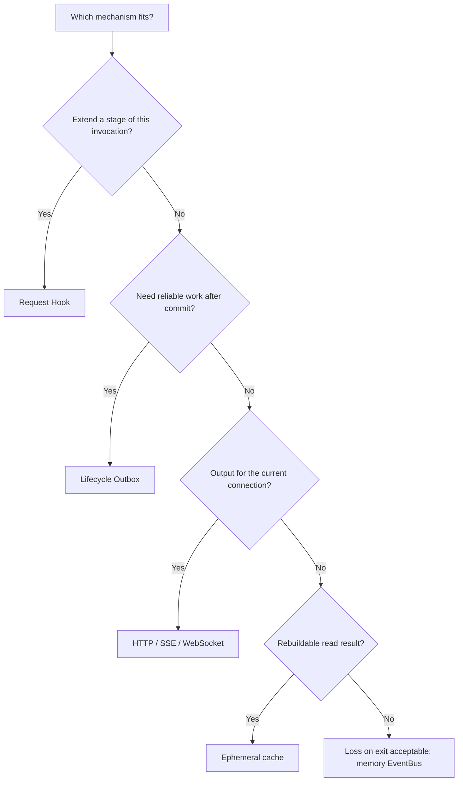
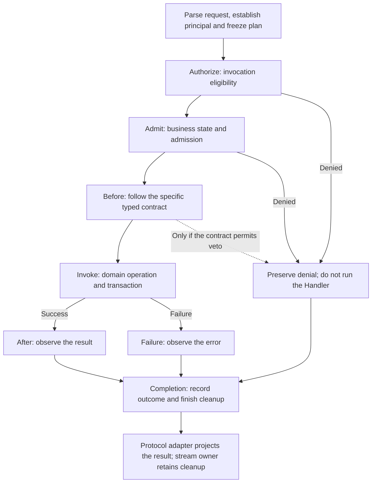
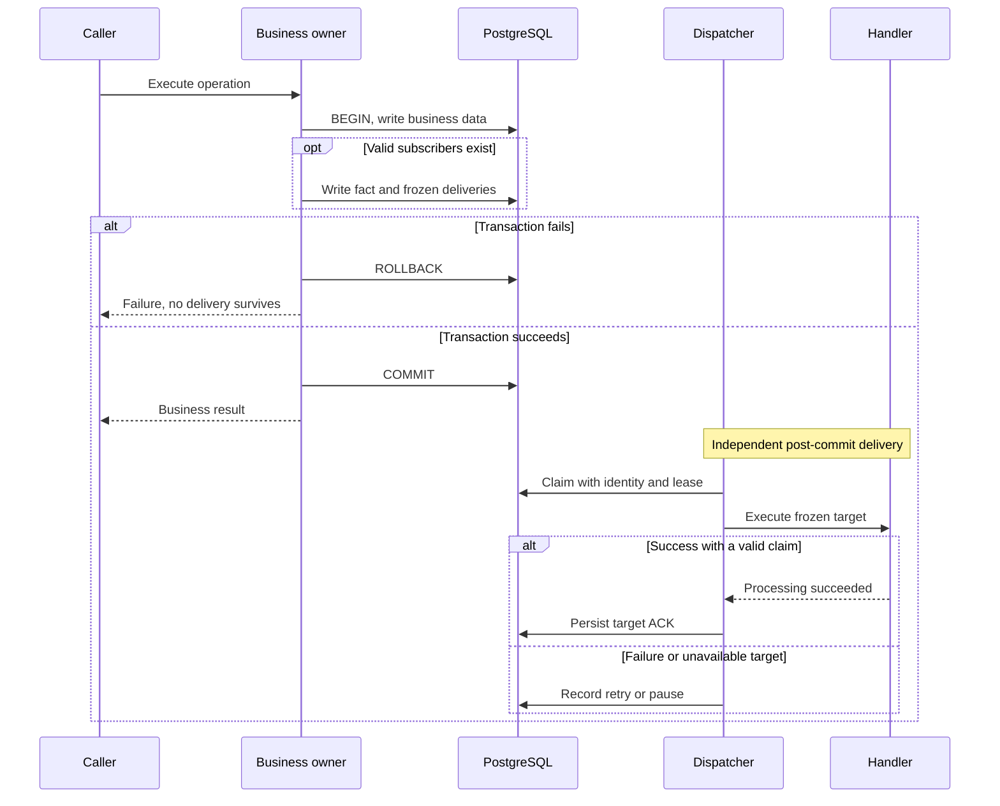
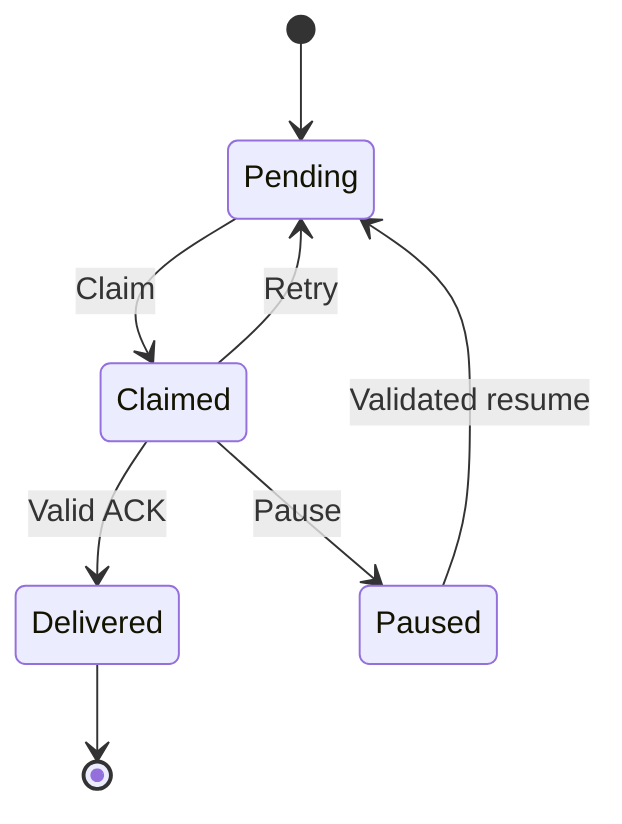
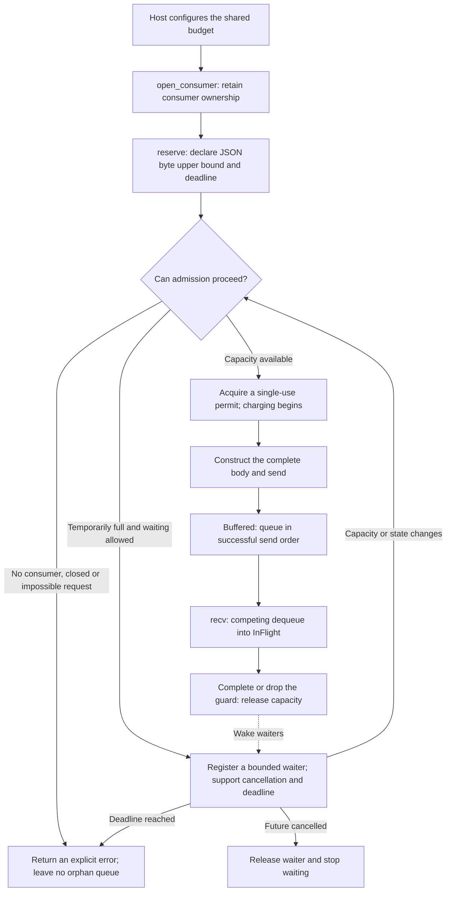

# Request, plugin and event lifecycles

[中文](plugin-lifecycle-contracts.md)

## What this system does

A single business operation in 1flowbase can involve request checks, database writes, plugin execution and follow-up notifications. Its event lifecycle defines **when each part runs, who owns it, what counts as completion and what happens after failure**.

For example, an authorized extension may need to react after a data model is published. The system must distinguish permission to execute, an actual database commit, successful extension processing and a durable acknowledgment. An unavailable extension must not turn an already committed publication into a failed business operation. Conversely, a rolled-back transaction must not leave a notification claiming that publication succeeded.

1flowbase uses several mechanisms with distinct responsibilities:

- **Request Hooks** participate in admission or observation at specified stages of the current invocation.
- **Lifecycle Outbox** persists committed facts and delivery obligations for subscribers to handle later.
- **The memory EventBus** hands complete events between components in one process, with consumer ownership and resource backpressure.
- **Protocol streams** return results to the current client using HTTP, SSE, WebSocket or another protocol.

This guide is for business developers, plugin authors and operators. Start with the scenarios and selection guide, then read the sections on reliable delivery, memory governance or plugin permissions. “Memory EventBus” here means the Host's `event-bus` infrastructure contract. The diagnostic event bus in `observability` has a separate role; sharing a name does not give it the resource or delivery guarantees described here.

## Why it exists

| Common problem | Mechanism | Result |
| --- | --- | --- |
| The business write succeeds, but the process exits before sending a notification | Commit business data, the fact and target delivery rows in one transaction | A recoverable delivery obligation survives the commit |
| Several plugins subscribe to one fact and one fails | Claim, execute and acknowledge each subscriber independently | Successful targets keep their receipts; failed targets are handled separately |
| A plugin is upgraded while older events remain unfinished | Freeze the original graph, subscriber and handler version | Old facts are not silently reinterpreted by a new implementation |
| Consumers exit while producers keep publishing | Require explicit consumer ownership for memory channels | Unowned events do not accumulate indefinitely |
| Consumers dequeue quickly but process slowly | Charge reservations, buffered events and in-flight processing against one budget | Backpressure covers processing, not just queue length |
| A plugin's observation error masks the original request error | Record invocation, notification and client-delivery outcomes separately | Preserve the primary business result and protocol semantics |

These boundaries separate control over the current invocation from the later processing of committed facts. Synchronous work, asynchronous obligations and resource lifetimes each have an explicit completion condition.

## Scenarios and selection



| Requirement | Suitable mechanism | Required decisions |
| --- | --- | --- |
| Check business eligibility or admission before execution | Business owner plus an available typed Hook phase | Plugins may use only the powers granted by that phase and cannot reverse a core denial |
| React to committed model facts or declared plugin events | Lifecycle Outbox | Event contract, frozen targets, effects and idempotency ownership |
| Hand off disposable temporary work inside one process | Memory EventBus | Consumer owner, shared budget, deadline and shutdown procedure |
| Stream a model response to a client | Original protocol stream | Stream terminal state, connection cleanup and client-delivery outcome |
| Speed up repeated reads of published orchestration startup information | Existing ephemeral cache | Rebuildability and validity; this kind of hot data can use an approximately five-minute cache |
| Read large, long-lived persisted context | Database lookup by key or index | Keep the database authoritative; do not copy entire contexts into memory channels or caches |

**Scenario 1: processing after commit.** An already supported business event commits with two authorized subscribers, A and B. A succeeds while B times out. The business operation remains committed, A keeps its receipt, and B retries or pauses according to policy. Delivery of the fact is complete only after both targets are acknowledged.

**Scenario 2: temporary work handoff.** An in-process component can hand rebuildable work to a worker through a memory channel. The worker holds consumer ownership; the producer reserves capacity before constructing the body. Admission fails explicitly after the owner exits. This illustrates a suitable use case; it does not mean that the system automatically creates a consumer or budget for every business feature.

**Scenario 3: streaming through the AI Gateway.** SSE or WebSocket response increments belong to the current request's protocol output. The stream owner must handle terminal state and cleanup. Model output does not automatically become a reliable Outbox notification merely because it is described as an event.

## Terms that should not be conflated

| Term | Question it answers |
| --- | --- |
| Invocation | Which execution is this, and which plan and identities did it freeze? |
| Hook | At which stage may an extension observe or make a particular decision? |
| Fact | What has already happened under which contract? |
| Subscriber / Handler | Who must process that fact, using which implementation version? |
| Delivery | Has the obligation to deliver one fact to one target been fulfilled? |
| Attempt / Claim | Who is executing this attempt, and when does its claim expire? |
| ACK | Which target's successful processing has been durably recorded? |
| Consumer owner / Delivery guard | Who owns a memory channel, and who still holds an in-flight event's resource charge? |

Always qualify “success.” A business commit is not subscriber completion; handler success is not a persisted ACK; server output completion is not proof that the client consumed it. Releasing a memory delivery guard records the end of ownership, not business success.

## Request Hooks: extending the current invocation

`plugin-framework` compiles typed execution plans from the Effective Extension Graph. The Composition Root injects active bindings and assembles those plans. An invocation freezes its Registry and Graph fingerprints. A new snapshot affects later invocations rather than replacing a plan during execution.



This diagram shows the responsibility flow; the frozen plan determines which phases apply. The domain owner retains the business transaction. The Kernel executes the compiled plan without taking over SQL transactions or plugin subprocesses. Observation failures in After, Failure or Completion cannot rewrite the primary result. For streaming invocations, the actual stream owner completes the lifecycle at termination; returning a stream object is not proof of completed delivery.

### What an ordinary managed plugin may do

| Phase | Generic managed interface (schema frame v1 / reference v2) | Legacy Create adapter |
| --- | --- | --- |
| Authorization / Admission | Continue or veto; cannot reverse a core denial | Original continue/veto behavior |
| Before | Observe only; no input mutation or veto | Read-only; may veto under the original contract, without input mutation |
| After / Failure / Completion | Observe only; cannot replace results or recover errors | Observation only; preserve the primary result |

A typed Hook capability in the Kernel does not grant every plugin the same wire permissions. Input mutation in another trusted contract requires explicit authority from that contract. Hooks cannot read raw credentials or bypass authentication, authorization, transactions, audit or domain state machines. See the [request architecture and invocation lifecycle](interface-lifecycle.en.md#execution-and-extensions) for detailed ordering.

Domains define and aggregate their own typed decisions: authorization Deny is absorbing, and constraints use the domain's safe intersection. There is no string-dispatched Hook handler, universal JSON decision or plugin-defined aggregation function that bypasses these rules.

## Lifecycle Outbox: how reliable notifications work

### Commit business changes and delivery obligations together

The Outbox closes the gap between writing business data and sending a notification. The transaction owner places business changes, the `AfterCommitFact`, the frozen subscription plan and per-target Deliveries in **one PostgreSQL transaction**. This notification Outbox is written only when active subscribers exist; no targets means no invented delivery work.



Rollback removes both the business changes and delivery obligations newly created by that transaction. The Dispatcher can observe them only after commit. A notification failure cannot roll back a committed operation or rewrite its original result or provider error. A subscriber that needs another business change must initiate a new `TypedCommand`.

### Each target has its own state

One fact may have several targets. This diagram describes the persistent state of **one target**, not the entire request or all subscribers together.



- `Pending`: waiting for an eligible attempt.
- `Claimed`: a worker owns a claim; the `claim_id`, worker and lease fence its updates.
- `Delivered`: success for this target is acknowledged. The fact is fully delivered only when every target reaches this state.
- `Paused`: the fact and obligation remain while execution conditions are restored or an explicit disposition is made. This is not success.

After lease expiry, a new claim can reclaim the record while its state remains `Claimed`. The stale attempt cannot update the new claim’s result.

The Dispatcher uses `SKIP LOCKED` for concurrent claiming. Each handler's deadline must fit within the claim lease. A timeout records `TimedOut` while other targets can continue. Batch, lease, retry and polling parameters are scheduling policy, not business payload-size limits.

### Retries, idempotency and frozen targets

Delivery attempts can repeat. A handler may commit an effect and then lose its process before the ACK is persisted, allowing another attempt. **At-least-once attempts do not by themselves mean that a business effect happens only once.**

| Guarantee | Boundary it protects | Remaining responsibility |
| --- | --- | --- |
| Claim fencing | A stale worker cannot overwrite the new claim's ACK or state | It cannot undo a side effect already executed by an external system |
| Stable event and subscriber identities | Identify effects for deduplication | Commit the deduplication receipt atomically with controlled effects |
| Frozen graph, handler and version | Keep delayed work attached to its original target | Pause when original artifacts or authority are unavailable; never silently substitute a version |
| Independent target ACKs | Preserve completed targets' results | Do not infer processing completion order across events |

The Host's supported owned collection typed upserts can commit together with their receipts. Arbitrary external HTTP calls, email or third-party effects still need the receiver's idempotency protocol. The Outbox does not promise network-wide exactly-once execution or global FIFO across events. Ordered business behavior requires domain object versions or explicit ordering constraints.

Managed plugin resume validates the exact Delivery's original frozen target, executable artifact and current authority. Upgrading a plugin does not automatically rebind old obligations. Permanent authorization revocation also prevents a promise of eventual delivery. `Paused` preserves an obligation; it is neither resumed nor delivered.

## Memory EventBus: governing absent and slow consumers

### Establish ownership and a budget first

The memory EventBus provides temporary in-process handoff without restart recovery. `MemoryEventBus::new()` starts empty and does not require a budget or consumers for Host startup. Before first use, the Host configures one budget shared across topics and opens consumer ownership handles. There is no guessed production capacity derived from the development machine.



`reserve` accepts no body, allowing admission before a large object is constructed. A permit still requires the sender to respect its declared byte bound. `send` validates the complete JSON and rejects an oversized body atomically, without truncation or partial delivery.

### Capacity follows an event until ownership ends

```text
Charged items = Reserved + Buffered + InFlight <= max_items
Charged logical bytes = sum of reserved upper bounds for unreleased events <= max_json_bytes
```

Dequeue changes the phase but **does not release capacity early**. Otherwise, a consumer could rapidly dequeue everything and start an unlimited number of processing tasks, moving the backlog into in-flight objects.

| Budget field | Resource governed |
| --- | --- |
| `max_items` / `max_json_bytes` | Total count and logical bytes shared by reservations, buffered events and in-flight events |
| `max_waiters` | Registered callers waiting in reserve or recv |
| `max_topics` / `max_consumers` | Topic generations and consumer ownership handles |
| `max_topic_name_bytes` | Total topic-name storage, including retired generations with live event leases |

All topics and clones of one bus share these limits. Reapplying the same configuration is idempotent; changing it to another configuration is rejected. Budget injection belongs to Host initialization, not an arbitrary user-facing message-capacity setting.

Accounting uses **upper bounds on serialized JSON bytes**, not exact heap or RSS usage. Copies deliberately created by callers are outside the channel's retained-resource accounting. Inspection display budgets are separate from admission budgets: limited previews do not truncate valid bodies or restore a fixed 1 MiB business message limit.

### Host-side API example

This is an API usage fragment. The real owner supplies `host_policy`, `body_upper_bound`, the deadline and processing functions. It is neither an external HTTP API nor a set of production defaults.

```rust
bus.configure_budget(host_policy)?;
let consumer = bus.open_consumer("temporary-work")?;

// Admit before constructing the body.
let permit = bus.reserve("temporary-work", body_upper_bound, deadline).await?;
permit.send(build_complete_json())?;

// Close admission after this send, retaining the consumer to drain accepted work.
consumer.close();
while let Some(delivery) = consumer.recv().await? {
    process_json(delivery.body()).await?;
    delivery.complete();
}
```

`EventDelivery` is not Clone, and exposes a borrowed body. Both `complete()` and Drop release the charge. If processing fails and the guard is dropped, capacity is still reclaimed; that is not business success and does not schedule automatic redelivery.

### Outcomes for missing consumers, overload and shutdown

| Condition | Observable result |
| --- | --- |
| No budget configured | `Unconfigured`; the empty bus still allows normal Host startup |
| Budget configured but no consumer owner | `NoConsumer`, without creating an orphan queue |
| Request exceeds the total budget, or waiter / directory capacity is exhausted | `ResourceExhausted`, rather than waiting forever for an impossible condition |
| Temporarily full and waiting is allowed | Register a waiter, recheck after capacity changes and return `DeadlineElapsed` at the deadline |
| A waiting future is cancelled | Release its waiter; an acquired permit releases its reservation on Drop |
| Body exceeds the reservation | `BodyExceedsReservation`, with no partial delivery |
| `consumer.close()` | Close admission for the entire topic generation; living consumers may continue draining |
| The last owner disappears | Terminate that generation, discard remaining buffered bodies and count actual abnormal termination / discards |

Consumers of the same topic **compete for one FIFO queue; they do not receive a broadcast**. FIFO governs dequeue order after successful enqueue, not processing completion order across consumers.

Graceful shutdown calls `close`, retains an owner, receives until `None`, and waits for its own processing tasks to finish and release their guards. Closing invalidates old permits for sending, but reservations and in-flight bodies remain charged until their leases are released. After abnormal loss of the last owner, old permits and waiters cannot publish into a recreated topic with the same name. Directory entries are reclaimed only after owners and live event leases are gone.

## Responsibilities of the platform and plugins

| Owner | Responsible for | Does not replace |
| --- | --- | --- |
| `extension-contracts` | Stable typed identities for Hooks, Facts, Commands and Completion | Business implementation or persistence |
| `plugin-framework` | Compile order, versions, permissions and handler registry from the Effective Graph | Actual subprocess runtime state |
| `api-server` Composition Root | Activate trusted factories, inject handlers and assemble Host infrastructure | Hard-coded plugin business logic in the delivery adapter |
| `interface-runtime` | Execute frozen invocation plans, phases and cleanup | Graph compilation, SQL transactions or Outbox scheduling |
| Domain / transaction owner | Business decisions, state changes and atomic business-plus-fact commits | Rolling back a committed operation through an asynchronous subscriber |
| Lifecycle Outbox / Dispatcher | Persistent delivery obligations, per-target claims, retries, pauses and ACKs | Idempotency at an external receiver |
| `storage-ephemeral` | Memory channels, ownership, shared charging, backpressure and inspection | Reliable ACKs, persistent recovery or business-success decisions |
| `runtime-extension-host` / SDK | Subprocesses, dispatch, call correlation, cancellation and exit cleanup; shared protocol handling | Reimplementing a Host communication protocol in every plugin |
| Plugin handler | Process content within its declared contract and permissions | Arbitrary SQL, database connections or Host credentials |

Trusted HostExtensions bind controlled factories through `native.library` and `native.entry_symbol`. Missing factories, bindings or matching contracts must reject assembly. Managed RuntimeExtension / CapabilityPlugin subscribers use the Host's managed transport, match an available event contract/version and hold contribution-level `event.subscribe` authorization.

Supported scopes follow the actual event contract. Managed event subscriptions expose Invocation / WorkspaceAssignment, not User scope. This is not a permanent scope definition for all managed contributions. Create committed and declared namespaced events each pass their applicable declaration, schema, authorization and frozen-identity checks. Successful compilation does not replace execution-time authority. See [plugin composition](plugin-composition.en.md) for selection guidance.

The AI Gateway retains its protocol mapping → AI Native → provider layers. Shared Kernel, Hook and event delivery mechanisms do not move those business responsibilities. Notification errors cannot mask original provider errors.

## Observability and troubleshooting

### Memory channels

Host memory management supports stats, entries, tree, search and explicit reveal. Inspection does not consume events, and bodies retain their sensitive-data contract. After budget configuration, a non-sensitive `event_bus_resources` metadata entry exposes resource state. An empty, unconfigured default bus may have no such entry.

| Observation | Question it answers |
| --- | --- |
| `reserved`, `buffered`, `in_flight`, `charged_json_bytes` | Is capacity held before construction, in the queue or during processing? |
| `waiters`, `oldest_waiter_age_ms` | Are producers or receivers waiting for a prolonged period? |
| `oldest_buffered_age_ms`, `oldest_in_flight_age_ms` | Is the backlog in queuing or execution? |
| `consumers`, `topics`, `closed_topics`, `retired_topics` | Are owners still present, and are old generations waiting for leases to be released? |
| `admission_rejected`, `accepted`, `received` | Are admissions failing, and is the queue progressing? |
| `processing_released`, `abnormal_terminations`, `discarded_buffered` | Is capacity returning, and have owners or buffered bodies been lost? |

`admission_rejected` counts errors returned by reserve/send; it excludes cancellation, budget configuration and consumer registration failures. `processing_released` includes both complete and Drop, so it is not a business-success metric. Ages describe the oldest currently retained object in each phase and are zero when that phase is empty.

### Reliable delivery

Identify a target by `event_id` and `subscriber_id`, then inspect its frozen graph/handler/version, status, `attempt_count`, `available_at`, claim expiry and `pause_reason`. First establish whether the business committed, then which targets are acknowledged, and finally address the failure cause.

| Symptom | Check first | Appropriate response |
| --- | --- | --- |
| Business succeeded but the plugin effect is missing | Whether an active target existed; its Delivery state and error | Investigate that target without relabeling the original operation as failed |
| The same event enters a handler again | Whether the effect committed, the ACK persisted or the claim expired | Deduplicate by stable identity; repetition alone does not prove a defect |
| `Paused` with an authority / installation reason | Current authorization and exact installation | Restore legitimate conditions before requesting exact resume; do not bypass permissions |
| `Paused` because the frozen graph / handler is unavailable | Original artifact, version and binding | Restore original execution conditions rather than impersonating the old target with a new version |
| Retry budget exhausted | Recent failure causes and effect idempotency | Repair the cause and use the formal resume path, not direct database status edits |
| Memory queue is empty but charges remain high | `reserved`, `in_flight` and retained permits/guards | Inspect construction and processing lifetimes, not only buffered count |
| `NoConsumer` or `Closed` | Owner startup order and the closing generation | Fix component lifetime management rather than blindly retrying into an unowned queue |

## Retention, caching and retired mechanisms

Memory channel data ends with the process lifetime. Do not use it for facts that must be processed after restart. Cache small, rebuildable hot data; fetch long-lived context from the database. Memory charge reclamation, cache eviction, reliable-fact retention and database GC have separate owners. Completion of one does not establish completion of the others.

The development-era Legacy Ledger, internal dual-version publication dispatch and associated recovery paths are retired. The original `model_definition.committed@v1` domain contract and body remain. Forward migration requires an explicitly emptied old queue and no unfinished old model deliveries. Otherwise retirement is rejected; applied SQLx migrations are not rewritten.

Current backup creation, validation and restore preserve source facts, frozen targets and valid receipts without packing the Legacy Ledger or internal legacy publication fields. Historical external backups containing the old queue format are outside this restore contract. Reliable-delivery retention, archival and GC require their own policies; `Delivered` does not imply automatic deletion.

Measure stored bodies / rows / indexes separately from WAL / IO and request CPU / latency. Queue retirement or resource accounting alone does not establish Gateway latency or throughput improvements, or a precise RSS bound.

## Further reading and source entry points

- [Request architecture and invocation lifecycle](interface-lifecycle.en.md): entry points, frozen plans, stream completion and extension permissions.
- [Plugin composition](plugin-composition.en.md): plugin types, scopes and contribution assembly.
- [Memory EventBus contract](../../api/crates/control-plane-contracts/src/ports/infrastructure/event_bus.rs): budgets, errors, ownership, permits, delivery guards and snapshots.
- [Memory EventBus implementation](../../api/crates/storage/ephemeral/src/local/memory_event_bus.rs): shared resource state, waiting, generations and inspection.
- [Outbox contract](../../api/crates/control-plane-contracts/src/ports/lifecycle_outbox.rs) and [Dispatcher](../../api/crates/control-plane/src/lifecycle_outbox_dispatcher.rs): per-target states, claims, retries and pauses.

Version-specific tests, runtime verification and release status belong in the relevant Issues, CI and delivery records. This guide explains mechanisms and contracts; a historical acceptance result is not a guarantee for every deployed version.
