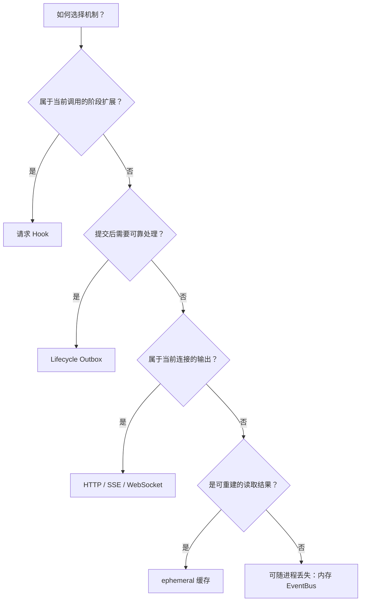
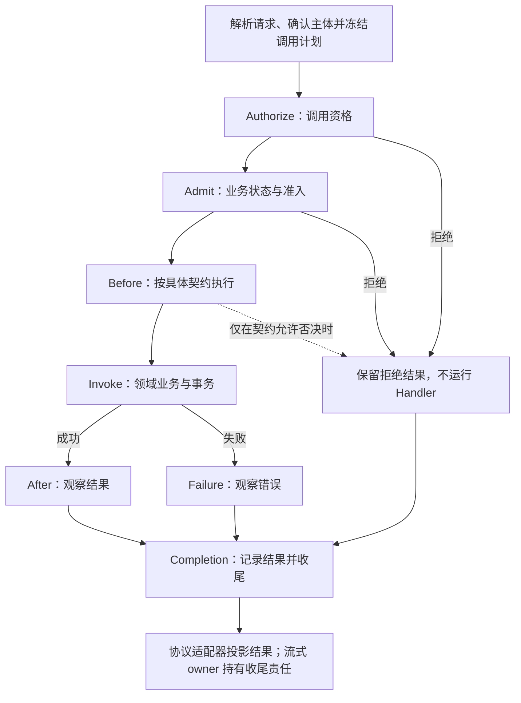
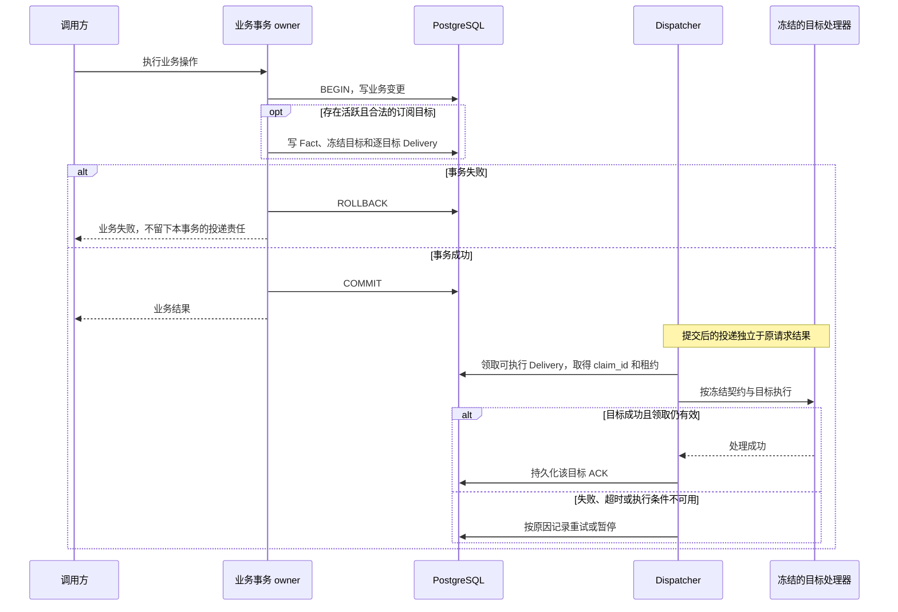
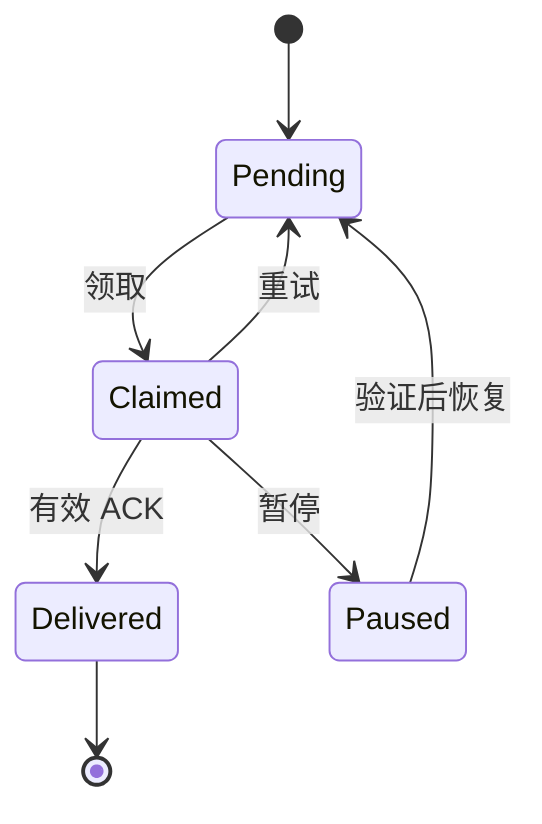
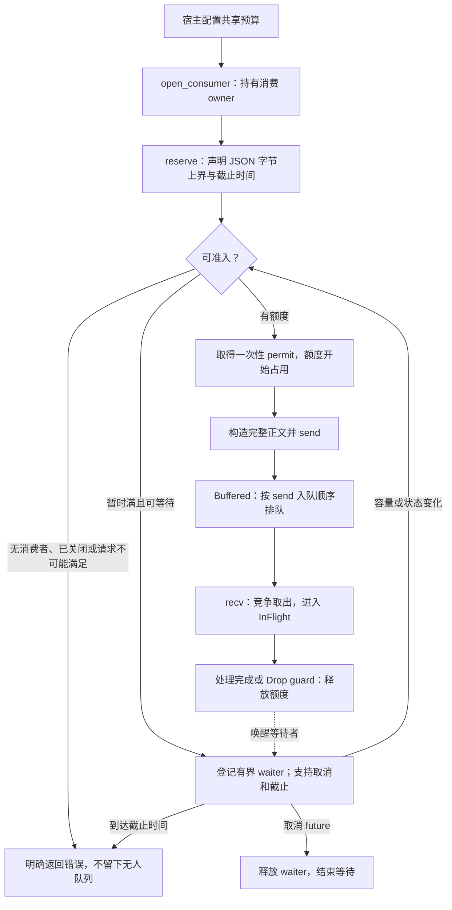

# 请求、插件与事件生命周期

[English](plugin-lifecycle-contracts.en.md)

## 这套机制是什么

在 1flowbase 中，一次业务操作可能同时涉及请求校验、数据库写入、插件执行和后续通知。事件生命周期描述这些工作在**什么时候发生、由谁负责、怎样确认完成，以及失败后如何继续**。

例如，数据模型发布成功后，某个已获授权的扩展需要处理这次变化。系统需要区分几个时刻：请求是否允许执行、模型是否真的提交、扩展是否已经处理，以及处理结果是否已持久确认。数据库提交后扩展暂时不可用，不应该把已经成功的发布改成失败；反过来，事务回滚也不应该留下“发布成功”的通知。

为此，1flowbase 使用几种职责明确的机制：

- **请求 Hook**：在当前调用的指定阶段参与准入或观察。
- **Lifecycle Outbox**：把已提交的事实和投递责任一起持久化，供订阅者稍后处理。
- **内存 EventBus**：在同一进程内临时交接完整事件，管理消费责任与资源背压。
- **协议流**：按 HTTP、SSE、WebSocket 等协议向当前客户端输出结果。

本文面向业务开发者、插件作者和运维人员。先阅读场景与选型，再按需要进入可靠投递、内存治理或插件权限部分。这里的内存 EventBus 指宿主 `event-bus` 基础设施契约；`observability` 中的运行诊断事件总线有独立职责，不能仅凭同名套用本文的资源和交付保证。

## 为什么需要它

| 常见问题 | 机制的作用 | 结果 |
| --- | --- | --- |
| 业务写库成功，进程在发送通知前退出 | 在同一事务中写业务、事实和目标投递记录 | 提交后保留可恢复的投递责任 |
| 多个插件订阅同一事实，其中一个失败 | 每个订阅者独立领取、执行和确认 | 成功目标保留收据，失败目标独立处理 |
| 插件升级后，旧事件还没有处理完 | 冻结事件当时的图、订阅者和处理器版本 | 旧事实不会被悄悄交给新版本重解释 |
| 消费者退出，生产者仍不断发布 | 内存通道要求明确的消费者 owner | 无人负责的事件不会无限积存 |
| 消费者处理慢，事件被取出后仍占着内存 | 预留、排队和处理中持续占用共享额度 | 背压覆盖处理阶段，不止覆盖队列长度 |
| 插件观察失败覆盖了原请求错误 | 调用结果、通知结果和客户端交付分别记录 | 保留主业务结果和原协议语义 |

这些机制把“本次调用能否继续”和“已经发生的事实如何被处理”分开，让同步请求、异步责任与资源生命周期各有明确的完成标准。

## 场景与选型



| 需求 | 适用机制 | 使用时必须明确 |
| --- | --- | --- |
| 执行前检查业务资格或准入条件 | 业务 owner + 已开放阶段的 typed Hook | 插件只能使用该阶段授予的能力，不能推翻核心拒绝 |
| 对已提交的模型事实或声明式插件事件作后续处理 | Lifecycle Outbox | 事件契约、冻结目标、处理效果和幂等责任 |
| 同进程组件之间交接可放弃的临时工作 | 内存 EventBus | 消费 owner、共享预算、截止时间与关闭方式 |
| 向客户端逐步输出模型响应 | 原协议流 | 流终态、连接收尾与客户端交付结果 |
| 加速反复读取已发布编排的启动信息 | 现有 ephemeral 缓存 | 可重建性和有效期；此类热数据可使用约五分钟缓存 |
| 读取长期持久化的大体量上下文 | 数据库主键或索引查询 | 数据库为真值，不整体复制进内存通道或缓存 |

**场景一：提交后的扩展处理。** 一个已支持的业务事件提交后，有两个获授权的订阅者 A、B。A 成功、B 超时，原业务仍保持已提交；A 的收据保留，B 根据策略重试或暂停。两个目标都确认成功后，该事实的交付才完整结束。

**场景二：临时工作交接。** 某个进程内组件可以用内存通道交给工作协程处理可重建任务。工作协程启动时持有消费 owner；生产者先预留额度，再构造正文。组件退出后，后续准入明确失败。这里是适用性示例，不代表系统自动为每个业务建立消费者或预算。

**场景三：AI Gateway 流式响应。** SSE 或 WebSocket 的响应增量属于当前请求的协议输出。请求流 owner 必须完成协议终态和收尾；模型输出不会因为需要“事件化”而自动进入可靠通知 Outbox。

## 先分清几个概念

| 概念 | 回答的问题 |
| --- | --- |
| Invocation（调用） | 哪一次业务执行，冻结了什么计划和身份？ |
| Hook（阶段扩展） | 在调用的哪个阶段，可以观察或作出哪种决定？ |
| Fact（已提交事实） | 哪个契约下的什么事情已经发生？ |
| Subscriber / Handler（订阅者 / 处理器） | 谁负责处理这个事实，使用哪一版实现？ |
| Delivery（投递责任） | 某个事实交给某个目标的工作是否完成？ |
| Attempt / Claim（尝试 / 领取） | 这一次由谁执行，领取资格何时到期？ |
| ACK（持久确认） | 哪个目标的成功处理已经被持久记录？ |
| Consumer owner / Delivery guard | 谁拥有内存通道，谁还持有处理中事件的资源额度？ |

“成功”必须附带对象。业务提交成功，不代表订阅者已处理；处理器返回成功，不代表 ACK 已持久化；服务端完成输出，也不等于客户端已经消费结果。内存 guard 释放只表示持有结束，不表示业务处理成功。

## 请求 Hook：当前调用如何经过扩展

`plugin-framework` 从有效扩展图（Effective Extension Graph）编译 typed 执行计划，Composition Root 注入激活的 binding 并完成装配。一次 Invocation 固定 Registry 和 Graph 的 fingerprint，新快照影响后续调用，不在执行中替换当前计划。



图中是责任主线，具体阶段是否适用由冻结计划决定。业务事务属于领域 owner；Kernel 执行已编译的计划，不接管 SQL 事务或插件子进程。After、Failure、Completion 的观察失败不能改写主结果。流式调用的 Completion 需要由实际 stream owner 在终态完成，不能在返回流对象时提前当作已经交付。

### 普通受管插件可以做什么

| 阶段 | 通用受管接口（schema frame v1 / reference v2） | 旧 Create adapter |
| --- | --- | --- |
| Authorization / Admission | 继续或否决；不能推翻核心拒绝 | 保留原来的继续或否决 |
| Before | 仅观察，不修改输入、不否决主调用 | 只读；可按原契约否决，不修改输入 |
| After / Failure / Completion | 仅观察，不能替换结果或恢复错误 | 保持观察语义，不改写主结果 |

Kernel 中存在某种 typed Hook，不等于所有插件都获得相同 wire 权限。其他可信契约的输入修改能力必须由该契约明确授予。Hook 不读取原始 credential，不绕过认证、授权、事务、审计或领域状态机。详细调用顺序见[请求架构与调用生命周期](interface-lifecycle.md#execution-and-extensions)。

领域 owner 定义并聚合自己的 typed Decision：权限 Deny 是吸收元，Constraint 使用领域安全交集。不开放绕过这些规则的字符串 Hook handler、万能 JSON Decision 或插件自定义 aggregation function。

## Lifecycle Outbox：可靠通知如何运行

### 业务和投递责任一起提交

Outbox 解决业务写入和通知发送之间的空隙：事务 owner 把业务变更、`AfterCommitFact`、冻结订阅计划和逐目标 Delivery 放进**同一个 PostgreSQL 事务**。有活跃订阅者时才写入该通知 Outbox；没有目标时，不凭空建立待投递工作。



事务回滚时，业务变更与本次新增的投递责任一起撤销；提交后 Dispatcher 才能看见它们。通知失败不能回滚已经提交的业务，也不能重写原调用结果或供应商错误。订阅者若要引起新的业务变化，应发起新的 `TypedCommand`。

### 每个目标有自己的状态

一个事实可以有多个目标。下面的状态图描述**单个目标**的持久投递状态，不代表整个请求或全部订阅者的状态。



- `Pending`：等待符合调度条件的尝试。
- `Claimed`：已被领取；`claim_id`、worker 与租约共同约束本次状态更新。
- `Delivered`：该目标的成功已确认。只有全部目标都达到此状态，事实才算完整交付。
- `Paused`：保留事实和责任，等待执行条件恢复或明确处置；它不是成功状态。

租约过期后，记录可以被新 claim 重新领取，状态仍为 `Claimed`；旧 attempt 无权更新新领取的结果。

Dispatcher 使用 `SKIP LOCKED` 支持并发领取。单个 handler 的执行 deadline 要留在领取租约内；超时记录 `TimedOut`，其他目标仍可继续。批次、租约、重试与轮询参数属于调度策略，不构成业务消息大小限制。

### 重试、幂等与冻结目标

投递允许重复尝试。例如，处理器已经完成效果，但进程在写 ACK 前退出，系统可能再次投递。因此，**至少一次尝试不等于业务效果只能发生一次**。

| 保障 | 管理的边界 | 仍需处理的事情 |
| --- | --- | --- |
| Claim fencing | 旧 worker 不能用过期领取覆盖新领取的 ACK 或状态 | 不阻止外部系统已经执行的副作用 |
| 稳定事件与订阅者身份 | 作为效果去重依据 | 去重收据必须与受控效果同事务提交 |
| 冻结 graph、handler 和版本 | 延迟工作继续指向原目标 | 原制品或权限不可用时暂停，不能偷换新版本 |
| 各目标独立 ACK | 保存已完成目标的结果 | 不保证不同事件的处理完成顺序 |

宿主开放的 owned collection typed upsert 可以与收据在同一事务提交。任意外部 HTTP、邮件或第三方系统副作用，仍需接收端提供相应幂等协议。Outbox 不承诺网络范围的 exactly-once，也不提供跨事件全局 FIFO；有顺序依赖的业务需要自己的对象版本或顺序约束。

受管插件恢复入口按精确 Delivery 验证原冻结目标、可执行制品和当前授权。插件升级不会自动把旧责任换绑到新实现；授权永久撤销时，也不能承诺最终送达。`Paused` 只保留责任，不等于已经恢复或已经交付。

## 内存 EventBus：怎样防止无人消费和慢消费积压

### 先确定消费者和预算

内存 EventBus 用于进程内短期交接，不提供重启恢复。默认 `MemoryEventBus::new()` 是空实例，没有预算和消费者也可以正常启动。首次使用前，由宿主明确配置一份跨 topic 共享的预算，再打开消费 owner；不存在根据开发机猜测的生产默认容量。



`reserve` 不接收正文，所以可以把容量准入放在大对象构造之前。拿到 permit 后仍需遵守所声明的字节上界；`send` 校验完整 JSON，超过预留会整体失败，不截断正文或部分投递。

### 额度跟随事件，直到持有结束

```text
已占事件数 = Reserved + Buffered + InFlight ≤ max_items
已占逻辑字节 = 所有未释放事件的预留字节上界之和 ≤ max_json_bytes
```

事件从队列取出时只改变阶段，**不提前释放额度**。否则，消费者只需快速取出并无限启动处理任务，就会把积压转移到处理中的对象上。

| 预算字段 | 约束对象 |
| --- | --- |
| `max_items` / `max_json_bytes` | 预留、排队和处理中事件共同占用的条数及逻辑字节 |
| `max_waiters` | 等待 reserve 或 recv 的登记者数量 |
| `max_topics` / `max_consumers` | topic generation 与消费 owner 的数量 |
| `max_topic_name_bytes` | topic 名称目录总字节，包含仍有活跃凭据的已退役 generation |

同一 bus 的 clone 和所有 topic 共用上述预算。相同配置重复注入是幂等的，运行中更换成另一份配置会拒绝。预算由宿主初始化负责，不是用户界面的任意消息容量开关。

计量使用**序列化 JSON 的逻辑字节上界**，不等于精确堆内存或 RSS。调用方自行复制正文的内存也不在通道持有额度中。检查页面的展示预算独立于接收预算，不因预览受限而截断合法正文，也不恢复固定的 1 MiB 业务消息上限。

### 宿主内部调用示例

以下是 API 使用片段；`host_policy`、`body_upper_bound`、截止时间和处理函数由实际 owner 提供。它不是外部 HTTP 接口，也不是生产默认参数。

```rust
bus.configure_budget(host_policy)?;
let consumer = bus.open_consumer("temporary-work")?;

// 先准入，再构造正文。
let permit = bus.reserve("temporary-work", body_upper_bound, deadline).await?;
permit.send(build_complete_json())?;

// 示例在发送后关闭准入，并保留 consumer 排空已接收事件。
consumer.close();
while let Some(delivery) = consumer.recv().await? {
    process_json(delivery.body()).await?;
    delivery.complete();
}
```

`EventDelivery` 不可 Clone，正文以借用方式提供。`complete()` 或 Drop 都释放额度；如果业务处理失败导致 guard 被丢弃，额度仍会回收，但这不代表业务成功，也不会自动重新投递。

### 无消费者、过载和关闭时会怎样

| 情况 | 可观察结果 |
| --- | --- |
| 未配置预算 | `Unconfigured`；空实例仍可正常随宿主启动 |
| 已配置但没有消费 owner | `NoConsumer`，不创建无人队列 |
| 单次请求超过总预算，或 waiter / 目录预算不足 | `ResourceExhausted`，不永久等待不可能满足的条件 |
| 暂时满但允许等待 | 登记 waiter；容量释放后重新判断，截止返回 `DeadlineElapsed` |
| 等待中的 future 被取消 | 回收 waiter；已取得的 permit 在 Drop 时释放预留 |
| 实际正文超过预留 | `BodyExceedsReservation`；无部分交付 |
| `consumer.close()` | 关闭整个 topic generation 的准入；活着的消费者继续 drain |
| 最后 owner 消失 | 终止该 generation，清理未取出正文，并记录实际发生的异常终止 / 丢弃计数 |

同 topic 的多个消费者**竞争同一个 FIFO 队列，不是广播**。FIFO 指成功入队后的取出顺序，不保证不同消费者的完成顺序。

正常关闭需要先 `close`，保留 owner，持续接收到 `None`，并等待自己持有的处理任务结束后释放相关 guard。关闭使旧 permit 不能再发送，但预留和处理中正文仍计量到凭据释放。最后 owner 异常退出后，旧 permit 或旧 waiter 不能投递到重新创建的同名 topic。目录在没有 owner 和活跃事件凭据后才回收。

## 底座与插件分别负责什么

| Owner | 负责 | 不替代 |
| --- | --- | --- |
| `extension-contracts` | Hook、Fact、Command、Completion 的稳定 typed identity | 业务实现和持久化 |
| `plugin-framework` | 从 Effective Graph 编译顺序、版本、权限与 handler registry | 子进程实际运行状态 |
| `api-server` Composition Root | 激活可信 factory，注入 handler，装配宿主基础设施 | 在 delivery adapter 内硬编码插件业务 |
| `interface-runtime` | 执行冻结的调用计划、阶段和收尾 | 图编译、SQL 事务和 Outbox 调度 |
| 领域 / 事务 owner | 业务判断、状态变化及业务与 Fact 的原子提交 | 用异步订阅者回滚已经提交的操作 |
| Lifecycle Outbox / Dispatcher | 持久投递责任、逐目标领取、重试、暂停和 ACK | 外部接收端的幂等协议 |
| `storage-ephemeral` | 内存通道、消费 owner、共享额度、背压与检查 | 可靠 ACK、持久恢复或业务成功判断 |
| `runtime-extension-host` / SDK | 子进程、通信分发、调用关联、取消与退出清理；共享协议处理 | 让每个插件自建一套宿主通信协议 |
| 插件 handler | 在声明的契约与权限内处理内容 | 取得任意 SQL、数据库连接或宿主 credential |

可信 HostExtension 通过 `native.library` 和 `native.entry_symbol` 绑定受控 factory；缺 factory、binding 或匹配契约时，装配应拒绝。受管 RuntimeExtension / CapabilityPlugin 使用宿主 managed transport，匹配开放事件的 contract/version，并具有逐贡献 `event.subscribe` 授权。

事件订阅支持的作用域以实际契约为准：受管事件订阅开放 Invocation / WorkspaceAssignment，User 作用域不开放。这不定义所有受管贡献的永久范围。Create committed 和声明式命名空间事件都要经过对应的声明、schema、授权与冻结身份校验，编译合法不能替代执行时授权。选型参见[插件组合](plugin-composition.md)。

AI Gateway 仍保持“映射协议层 → AI Native → 供应商”。共享 Kernel、Hook 与事件投递不改变这三层业务责任，通知错误不能覆盖供应商原始错误。

## 如何观察与排查

### 内存通道

宿主内存管理提供 stats、entries、tree、search 与显式 reveal。检查不取走事件；正文保持敏感数据契约。配置预算后，非敏感的 `event_bus_resources` 元数据记录展示资源状态；空且未配置的默认 bus 可以没有这条记录。

| 观察项 | 能回答的问题 |
| --- | --- |
| `reserved`、`buffered`、`in_flight`、`charged_json_bytes` | 额度停留在构造前、队列中还是处理中？ |
| `waiters`、`oldest_waiter_age_ms` | 生产者或接收者是否在持续等待？ |
| `oldest_buffered_age_ms`、`oldest_in_flight_age_ms` | 积压在排队还是执行阶段？ |
| `consumers`、`topics`、`closed_topics`、`retired_topics` | 是否还有 owner，是否有等待凭据释放的旧 generation？ |
| `admission_rejected`、`accepted`、`received` | 接收失败与队列推进情况如何？ |
| `processing_released`、`abnormal_terminations`、`discarded_buffered` | 额度是否回收，是否发生 owner 异常退出和正文丢弃？ |

`admission_rejected` 统计 reserve/send 返回错误，不包含取消、预算配置或消费者注册失败。`processing_released` 包括 complete 与 Drop，不可拿来计算业务成功率。年龄表示当前仍在该阶段的最老对象，空阶段为零。

### 可靠投递

按 `event_id` 与 `subscriber_id` 定位目标，检查冻结 graph/handler/version、status、`attempt_count`、`available_at`、claim 到期时间和 `pause_reason`。先判断业务是否提交，再判断各目标是否确认，最后处理失败原因。

| 现象 | 优先检查 | 合理处理 |
| --- | --- | --- |
| 业务成功，插件效果没有出现 | 是否有活跃目标；该 Delivery 的状态与错误 | 排查具体目标，不把原业务改为失败 |
| 同一事件再次进入 handler | 上次效果是否提交、ACK 是否成功、claim 是否过期 | 使用稳定身份去重，不按“重复调用”直接判错 |
| `Paused` 且 reason 为 authority / installation | 当前授权和精确安装是否仍有效 | 恢复合法条件后请求精确恢复，不能绕过权限 |
| `Paused` 且冻结 graph / handler 不可用 | 原制品、版本和 binding | 恢复原执行条件，不能用新版本冒充旧目标 |
| 重试预算耗尽 | 最近失败原因与效果幂等状态 | 修复原因后按正式入口恢复，不直接改数据库状态 |
| 内存队列已空但占额仍高 | `reserved` 与 `in_flight`，调用方是否持有 permit/guard | 检查构造或处理生命周期，不能只看 buffered |
| `NoConsumer` 或 `Closed` | owner 启动顺序与关闭 generation | 修正组件生命周期，勿靠盲目重试创建无人队列 |

## 数据保留、缓存与旧机制的边界

内存通道的数据随进程生命周期结束，不用它保存跨重启必须处理的事实。短期可重建热数据可以缓存，长期上下文仍从数据库读取。内存额度回收、缓存淘汰、可靠事实保留与数据库 GC 是不同责任，不能用其中一项的完成推导其他项已经处理。

开发期 Legacy Ledger、内部双版本发布分派及对应恢复路径已经退役；原始 `model_definition.committed@v1` 领域契约和正文继续保留。向前迁移要求旧队列经过明确处置而为空，且旧模型事实没有未完成交付；不满足时拒绝退役，不改写已应用的 SQLx migration。

当前备份创建、校验与还原保留源事实、冻结目标和有效收据，不再打包 Legacy Ledger 或内部旧发布字段。历史外部备份中的旧队列格式不在这套恢复契约内。可靠投递的保留、归档和 GC 需要自己的政策，不能因为一条记录已 Delivered 就推导它会自动删除。

性能应分别度量存储正文 / 行 / 索引、WAL / IO，以及请求 CPU / 延迟。队列退役或资源计量本身不等于已经获得 Gateway 延迟、吞吐或精确 RSS 上限保证。

## 继续阅读与源码入口

- [请求架构与调用生命周期](interface-lifecycle.md)：请求入口、冻结计划、流式收尾与扩展权限。
- [插件组合](plugin-composition.md)：插件类型、作用域与贡献装配。
- [内存 EventBus 契约](../../api/crates/control-plane-contracts/src/ports/infrastructure/event_bus.rs)：预算、错误、owner、permit、delivery guard 和快照。
- [内存 EventBus 实现](../../api/crates/storage/ephemeral/src/local/memory_event_bus.rs)：共享资源状态、等待、generation 和检查。
- [Outbox 契约](../../api/crates/control-plane-contracts/src/ports/lifecycle_outbox.rs)与[Dispatcher](../../api/crates/control-plane/src/lifecycle_outbox_dispatcher.rs)：逐目标状态、领取、重试与暂停。

具体版本的测试、运行验证和发布状态由对应 Issue、CI 与交付记录维护；本文解释机制与契约，不把某次验收结果作为所有部署版本的保证。
