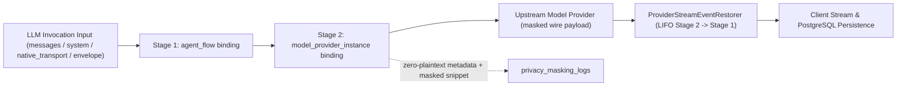

# Privacy Masking Architecture (`隐私脱敏`)

## Overview

`1flowbase` separates **hot-path privacy redaction/restoration** from **control-plane configuration UI**:

- **Host Privacy Masking Kernel (`api/crates/control-plane/src/privacy_masking/`)**: In-process Rust execution kernel owning 12 built-in rule families, linear-time custom regex compilation (`regex` crate DFA/size bounded, empty-match rejected), deterministic workspace-scoped HMAC-SHA256 base32 placeholder synthesis (`{{KIND_<8-char-tag>}}`), sequential subject routing-chain evaluation, chunk-boundary-safe LIFO streaming restoration, and a memory-only continuation vault.
- **Host Service Contract (`privacy-masking/v1`)**: Multiplexed over the existing managed worker stdio channel (`MultiplexHostService::PrivacyMaskingV1`) with host-bound caller identity (`PrivacyMaskingBinding`), capability-checked permissions (`privacy.subjects.read`, `privacy.policy.sync`, `privacy.logs.read`), and zero trust in worker-claimed workspace/actor IDs.
- **Control-Plane Plugin (`@taichuy/privacy-masking`)**: Official v2 `managed_service` + `settings_pages` plugin storing workspace authoring state in plugin `owned_collections` and syncing compiled runtime policies to the host on every save.

## Data Flow & Subject Chaining

- **Sequential Chaining**: When both the executing `agent_flow` and target `model_provider_instance` match enabled bindings, Stage 1 (`agent_flow`) runs first, followed by Stage 2 (`model_provider_instance`) over Stage 1's output. Existing `{{KIND_xxxxxxxx}}` tokens are skipped by built-ins for idempotency; hypothetical nested double-masking unwinds losslessly in LIFO order.
- **Fail-Closed**: Policy load, regex compilation, or `native_transport` digest recomputation failures abort the upstream model call before any payload leaves the host.
- **Persistence Semantics**:
  - `restore_output = true` (default): Upstream wire payload is masked; streaming text, reasoning, tool calls, output items, and final outputs are restored before client projection and PostgreSQL persistence.
  - `restore_output = false`: Upstream wire payload and downstream outputs stay masked and are persisted as masked (`脱敏入库`), including `node_runs.debug_payload`, `native_trajectory`, and `native_response.history`.
- **Zero-Plaintext Boundaries**:
  - `privacy_masking_logs` records only structured metadata (`rule_id`, `placeholder_kind`, `placeholder`, `original_len`, `prefix_hint`, `hit_count`, `restored_count`, `masked_snippet` sliced strictly from the masked text).
  - Plaintext restoration maps exist solely in Rust process memory (request-scoped `RestorationStack` + bounded 2048-entry / 30m TTL in-memory continuation vault) and are never written to PostgreSQL or `storage/ephemeral`.

## Atomic Lifecycle Fencing

`privacy_masking_runtime_policies` is atomically purged inside the PostgreSQL transaction and invalidated in-process via `PrivacyMaskingInvalidationObserver` whenever the owning plugin installation is:

1. Disabled (`PluginRepository::update_desired_state`),
2. Uninstalled (`PluginRepository::commit_plugin_family_uninstall`),
3. Replaced/retired during version switch (`PluginContributionAuthorityRepository::commit_with_catalog`), or
4. Revoked of `privacy.policy.sync` (`PluginContributionAuthorityRepository::revoke_contribution_authorization`).

Additionally, active policy queries join `extension_installations.desired_state = 'active_requested'` and active `plugin_contribution_authorizations` grants as defense-in-depth.
