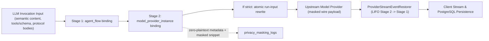

# Privacy Masking Architecture (`隐私脱敏`)

## Overview

`1flowbase` separates **hot-path privacy redaction/restoration** from **control-plane configuration UI**:

- **Host Privacy Masking Kernel (`api/crates/control-plane/src/privacy_masking/`)**: In-process Rust execution kernel owning 12 built-in rule families, linear-time custom regex compilation (`regex` crate DFA/size bounded, empty-match rejected), deterministic workspace-scoped HMAC-SHA256 base32 placeholder synthesis (`{{KIND_<8-char-tag>}}`), sequential subject routing-chain evaluation, chunk-boundary-safe LIFO streaming restoration, and a memory-only continuation vault.
- **Host Service Contract (`privacy-masking/v1`)**: Multiplexed over the existing managed worker stdio channel (`MultiplexHostService::PrivacyMaskingV1`) with host-bound caller identity (`PrivacyMaskingBinding`), capability-checked permissions (`privacy.subjects.read`, `privacy.policy.sync`, `privacy.logs.read`), and zero trust in worker-claimed workspace/actor IDs.
- **Control-Plane Plugin (`@taichuy/privacy-masking`)**: Official v2 `managed_service` + `settings_pages` plugin storing workspace authoring state in plugin `owned_collections` and syncing compiled runtime policies to the host on every save.

## Data Flow & Subject Chaining

- **Sequential chaining**: Stage 1 (`agent_flow`) runs before Stage 2 (`model_provider_instance`). Built-ins skip existing placeholder spans; custom rules may wrap a placeholder but cannot match an existing token verbatim. Overlap and exact-match checks use binary search over sorted, non-overlapping spans.
- **Provider boundary**: Mask message and system text, tool/MCP descriptions and parameter schemas, response schemas, content-bearing request context, and both native and semantic protocol bodies. Keys such as `id`, `type` and `model` are preserved only at known wire-object boundaries. A nested user payload or schema has no such exemptions. Do not rewrite routing identifiers, tool names, host connection credentials, or opaque continuation fields. Recompute the native body digest and byte size after masking.
- **Fail closed**: Policy load/compile, digest calculation, and a required PostgreSQL rewrite must succeed before the provider call starts.

### Durable run data and restoration

With `restore_output = true` throughout the chain, the invocation is masked upstream and restored in LIFO order before downstream projection; the ordinary PostgreSQL input path is unchanged. With a `restore_output = false` binding, that stage's values stay masked in provider output and in the debug/native persistence views. Restoring another stage cannot reintroduce a value matched by a strict rule.

For a strict invocation with a `flow_run_id`, the Kernel also applies the staged policy to the existing run snapshot, unwinding only eligible stages **before** calling the provider. One PostgreSQL transaction replaces `flow_runs.input_payload`, its lossless sidecar, and the title. It rewrites existing node inputs (physically in `node_run_details`), other retained node copies, and stored node-event snapshots of those payloads (including replacing archive references and reclaiming unshared observation-owned originals), without changing the executor's in-memory inputs. Generated titles are rebuilt from masked inputs rather than operated on as potentially truncated secrets. Previously materialized trace I/O is rewritten, and run conversation items and application-run log summaries/tasks are refreshed in the same transaction. `assistant_conversations` itself stores identities and timestamps, not a copy of the user prompt.

### Audit records and streaming

`privacy_masking_logs` contains rule and placeholder metadata, counts, and the original length, but `prefix_hint` is always empty. Invocation and preview both derive `masked_snippet` only after the last masking stage: the first visible placeholder occurrence plus up to 24 characters on either side. If a later rule wrapped the occurrence and no direct occurrence is left, the snippet is the placeholder alone. No intermediate snippet or plaintext restoration map is persisted. The request restoration stack and the bounded, 2,048-entry/30-minute continuation vault live only in memory.

The stream restorer tracks semantic text/reasoning/calls and native event channels separately. Responses text, refusal, reasoning, summaries, function arguments and custom tool input, and Anthropic text/thinking/partial JSON can all split a placeholder across chunks. Native receivers flush the relevant channel at its done/block-stop event and flush remaining channels at completion or stream exit. For serialized tool argument deltas, only the final LIFO-restored replacement is escaped as JSON string content, exactly once. Already structured JSON values receive direct string replacement instead.

## Atomic Lifecycle Fencing

`privacy_masking_runtime_policies` is atomically purged inside the PostgreSQL transaction and invalidated in-process via `PrivacyMaskingInvalidationObserver` whenever the owning plugin installation is:

1. Disabled (`PluginRepository::update_desired_state`),
2. Uninstalled (`PluginRepository::commit_plugin_family_uninstall`),
3. Replaced/retired during version switch (`PluginContributionAuthorityRepository::commit_with_catalog`), or
4. Revoked of `privacy.policy.sync` (`PluginContributionAuthorityRepository::revoke_contribution_authorization`).

Additionally, active policy queries join `extension_installations.desired_state = 'active_requested'` and active `plugin_contribution_authorizations` grants as defense-in-depth.

A workspace mutation evicts that workspace and increments its generation; an installation invalidation clears the cache and increments a global generation. A cold loader snapshots both before querying PostgreSQL and may publish only if both still match under the cache write lock. It retries at most three reads and fails closed if invalidation keeps racing the load.
